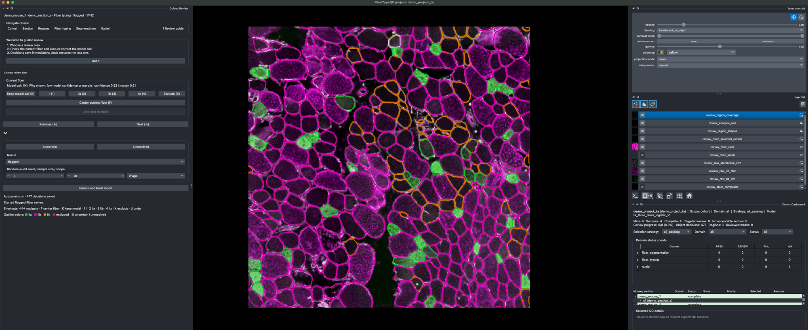

# FiberTypeQC

**Muscle fiber segmentation, fiber typing, quality control, and guided human review for
immunofluorescence histology, with auditable, analysis-ready outputs.**

Fiber-type composition of skeletal muscle is usually measured by hand or with per-image threshold
tools. Manual typing is slow and varies between people; automated calls are rarely checked
systematically, and corrections are often made directly in result tables, so it is hard to tell
afterwards which values came from software and which from a person. FiberTypeQC is a Python
workflow for multi-channel muscle sections (Zeiss CZI or TIFF) that keeps every step inspectable:
it segments fibers, types them with a model matched to the staining panel, flags results that need
a human look, records the reviewer's decisions separately from the model's predictions, and builds
image-, mouse-, and cohort-level tables and a report.

```text
images ─► segment (Cellpose) ─► type (panel-specific model) ─► QC flags
       ─► guided review (Napari) ─► finalize (predictions untouched) ─► tables + HTML report
```



## Status

Version 0.3.0. Read before relying on results:

- **Models are panel-specific.** A model works only on the staining panel it was trained on; the
  pipeline refuses a mismatched panel. The default, `quad_four_class_rf_v1`, is for laminin, Type I,
  IIa, and IIb panels (IIx inferred from absent signal).
- **No accuracy claims yet.** The released models have not been validated on a blinded random
  hold-out sample; see their [model cards](docs/model_cards/). Use them for review-assisted
  analysis.
- **Model files are release downloads**, verified by SHA-256; they are not in the repository.
- Nuclear segmentation and extra-marker (eMHC, direct IIx) measurements are experimental.

## Install and try it

macOS or Linux, with [`uv`](https://docs.astral.sh/uv/) (it installs Python 3.11 and the locked
dependencies). A GPU is optional.

```bash
git clone https://github.com/jrconner16/fibertypeqc.git
cd fibertypeqc
uv sync --frozen                             # first run downloads several GB (PyTorch)
uv run python -m scripts.run_reference       # synthetic end-to-end check; no data needed
```

Then follow the [demo](docs/demo.md): four small public fields from download to the HTML report.
Details, HPC notes, and model downloads: [docs/install.md](docs/install.md).

## Run your own images

```bash
uv run python -m fibertypeqc init     myproject/ --images /path/to/images   # panel, samples, model
uv run python -m fibertypeqc run      myproject/   # segment, type, and QC every image
uv run python -m fibertypeqc prepare  myproject/   # review project and project QC
uv run python -m fibertypeqc review   myproject/   # guided review in Napari
uv run python -m fibertypeqc finalize myproject/   # finalized tables and cohort report
uv run python -m fibertypeqc status   myproject/   # where am I, and what next
```

The [user guide](docs/user_guide.md) covers project setup, outputs, QC checks, models,
troubleshooting, and single-image commands.

## What it does

- **Ingest:** CZI and TIFF, multi-scene CZIs split deterministically, channel roles from a panel
  file or preset.
- **Segment:** Cellpose on the laminin channel; per-fiber area and Feret diameters.
- **Type:** panel-specific scikit-learn models with pinned feature extraction; each model declares
  its panel, features, and classes, and is identified by SHA-256.
- **QC:** per-image checks (fiber count, uncertainty, inferred-class share, fiber size, channel
  crosstalk) and per-fiber flags (low confidence or margin, faint or thick laminin outline).
- **Review:** a Napari workspace with a cohort dashboard, section pass/fail/exclude, a guided queue
  of flagged fibers that says why each is shown, and drawn exclusion regions and analysis ROIs.
- **Finalize:** applies review decisions and exclusions into new tables; every final value is
  labelled `predicted`, `reviewed`, `excluded`, or `unresolved`; refuses decisions made on inputs
  that have since changed.
- **Report:** image, mouse, ROI, and cohort tables, and a self-contained HTML report comparing
  predicted and finalized results.
- **Measure and adapt:** blind reference labelling (model output hidden) with reviewer agreement;
  candidate models trained from review decisions and compared under a rule fixed in advance;
  explicit, reversible promotion; reproducibility snapshots.

## How QC and review fit together

The model's per-fiber table is written once and never edited. Automatic QC decides which fibers
and sections a person should look at; the reviewer's decisions are saved as a separate review
state; finalization combines the two into new tables, recording where each value came from. See the
[review guide](docs/review_guide.md).

## Documentation

| For | Read |
|---|---|
| Users | [Install](docs/install.md) · [Demo](docs/demo.md) · [User guide](docs/user_guide.md) · [Review guide](docs/review_guide.md) · [Panels](docs/panel_schema.md) · [Outputs](docs/output_schema.md) · [Model cards](docs/model_cards/) |
| Developers | [Architecture](ARCHITECTURE.md) · [Contributing](CONTRIBUTING.md) · [Model registry](docs/model_registry.md) · [All docs](docs/README.md) |
| Project | [Changelog](CHANGELOG.md) · [Roadmap](ROADMAP.md) |

### A five-minute tour of the code

1. [ARCHITECTURE.md](ARCHITECTURE.md): the supported surface, data contracts, and the boundary
   between product code and research tooling.
2. [src/cli.py](src/cli.py): the project-folder workflow behind `python -m fibertypeqc`.
3. [src/review/finalization.py](src/review/finalization.py): how review decisions and exclusions
   become final values without touching predictions.
4. [fibertypeqc/model_manifest.py](fibertypeqc/model_manifest.py) and
   [fibertypeqc/model_resolution.py](fibertypeqc/model_resolution.py): panel-compatibility checks
   and digest-verified model loading.
5. [src/model_improver.py](src/model_improver.py) with
   [manifests/improver/recipe.v1.yaml](manifests/improver/recipe.v1.yaml): candidate models
   evaluated on held-out mice under a pre-declared promotion rule.
6. [.github/workflows/ci.yml](.github/workflows/ci.yml) and
   [scripts/run_reference.py](scripts/run_reference.py): what every change must pass.

## Tests

```bash
uv sync --frozen --extra dev
uv run pytest -m "not integration" -q          # fast synthetic tests
uv run python -m scripts.run_reference         # end-to-end synthetic workflow
uv run python -m scripts.check_repository      # links, tracked artifacts, private-data guardrails
```

CI runs these, plus linting and a smoke test of every public command, on each push.

## Repository layout

```
fibertypeqc/  Contracts: panels, model manifests and registry, QC, provenance, reports
src/          Pipeline, review, finalization, and results implementation
scripts/      Public commands (python -m scripts.<name>)
manifests/    Model registry, model manifests, panel presets, improver recipe
examples/     Synthetic reference images and models, example outputs
docs/         User and developer documentation; docs/history/ holds superseded plans
tests/        Synthetic tests
research/     Study and model-development tooling; not part of the supported surface
validation/   Command wrappers over research validation tools
```

## Citation, license, and contact

If you use FiberTypeQC, please cite it with the version you used; GitHub's "Cite this repository"
button gives the citation from [CITATION.cff](CITATION.cff). MIT License; see
[LICENSE](LICENSE). Questions and bug reports: open an
[issue](https://github.com/jrconner16/fibertypeqc/issues). Contributions: see
[CONTRIBUTING.md](CONTRIBUTING.md).

This repository is public: do not commit microscopy data, real specimen identifiers, results from
unpublished data, or models trained on them; see [AGENTS.md](AGENTS.md).
