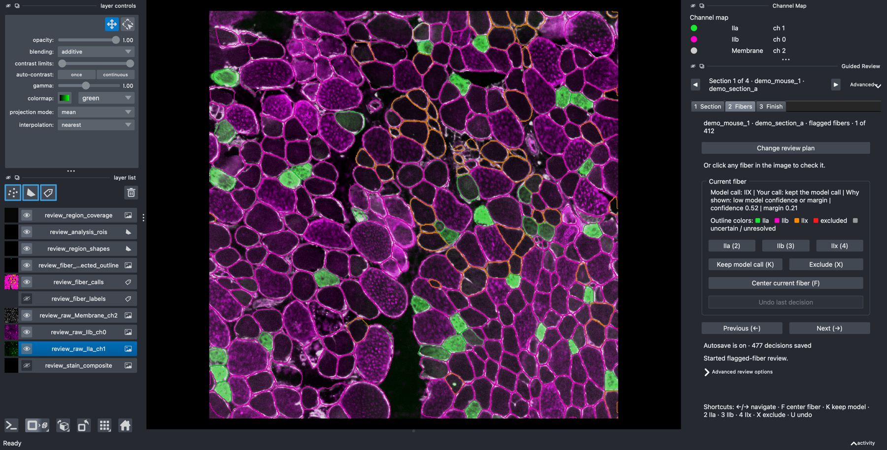

<!--
Draft status (remove before submission):
- Describes v0.5.1 (released 2026-11-17; Zenodo v0.5.0 DOI 10.5281/zenodo.24321794, v0.5.1 DOI
  pending). The paper claims released features only.
- AUTHOR NOTES (2026-11-17) are outlines and facts for the author to write from; they are not
  proposed wording. Each points to the evidence in the claim map at the end.
- Still to finish (authors): research impact statement, AI usage disclosure, acknowledgements.
- Leave out of the paper: eMHC builder classes (experimental, synthetic tests only); nuclei in
  results (experimental, central cut-off unchecked); any accuracy figures.
- JOSS limit: 750-1750 words, front matter, comments, and references excluded (about 1,300 rendered words on 2026-11-17).
-->

# Summary

FiberTypeQC is an open-source Python workflow for skeletal muscle immunofluorescence analysis that
combines Cellpose segmentation [@Stringer2021Cellpose; @Stringer2025Cellpose3], feature-based
fiber-type classification, morphometry, and guided quality-control review. It uses panel-specific
scikit-learn [@Pedregosa2011sklearn] models to classify fibers and a napari [@napari] interface to
inspect questionable results. Rather than replacing automated predictions with manual corrections,
FiberTypeQC preserves both and records their provenance in finalized outputs. The software also
supports blind reference labeling, controlled model improvement, and reproducible cohort-level
reporting. Its purpose is to make high-throughput fiber typing practical without sacrificing human
oversight or traceability.

# Statement of need

Skeletal muscle fiber typing is widely used to study muscle physiology, disease, and regeneration.
Traditional approaches require substantial manual intervention or user-selected fluorescence
thresholds. These methods can produce useful results, but differences in staining intensity, image
quality, and threshold selection complicate comparisons between experimental cohorts.

FiberTypeQC originated from the need to analyze large collections of muscle sections without
manually inspecting every fiber. One internal analysis involved approximately 200,000 fibers,
making exhaustive manual review impractical. Automation reduced this workload but introduced a
different problem: classifiers could produce plausible predictions on images whose staining
characteristics differed from their training data.

Type IIx illustrates the difficulty. In commonly used staining panels, IIx is inferred from the
absence of other myosin heavy-chain signals. A weakly stained IIa or IIb fiber may therefore
resemble an IIx fiber, despite representing a different biological phenotype.

The practical challenge is not simply automating classification, but identifying where automation
may be unreliable and directing expert attention there. FiberTypeQC was designed to support this
combination of automated analysis, targeted review, and reproducible reporting.

# State of the field

Existing tools including MyoSight [@Babcock2020MyoSight], Myosoft [@EncarnacionRivera2020Myosoft],
MuscleJ [@MayeufLouchart2018MuscleJ], MuscleJ2 [@Danckaert2023MuscleJ2], QuantiMus
[@Kastenschmidt2019QuantiMus], and FiNuTyper [@Lundquist2023FiNuTyper] provide methods for
skeletal muscle segmentation, fiber typing, morphometry, and related measurements.
General-purpose platforms such as QuPath [@Bankhead2017QuPath] and ilastik [@Berg2019ilastik]
also support segmentation, feature extraction, interactive classification, and model training.

FiberTypeQC does not introduce a new segmentation algorithm or fundamentally new classification
method. Its contribution is a defined, muscle-specific workflow connecting automated analysis,
quality-control triage, human review, model adaptation, and finalized cohort-level results.

Similar capabilities can be assembled using general-purpose platforms. However, doing so requires
researchers to establish their own conventions for tracking predictions, recording corrections,
detecting changes to reviewed inputs, maintaining compatible models, and aggregating results
across experiments.

FiberTypeQC implements these conventions as part of the software. This trades some of the
flexibility of general-purpose platforms for a reproducible workflow tailored to skeletal muscle
immunofluorescence analysis.

# Software design

FiberTypeQC was designed around several practical choices intended to balance automation,
interpretability, adaptability, and reproducibility.

**Project-level workflow.** A command-line interface, and an experimental desktop launcher that
runs the same commands, manage initialization, image analysis, QC preparation, review,
finalization, and reporting. Each stage produces structured
outputs that can be inspected or reused. This staged approach introduces additional workflow
management compared with a single automated processing command, but makes the analysis state and
review requirements explicit across an entire cohort. FiberTypeQC also supports execution on
high-performance computing (HPC) infrastructure. Batch processing can be run on Slurm-managed
systems, while interactive napari review has been tested through Open OnDemand remote desktop
sessions. This allows researchers to process and review large microscopy images without relying
exclusively on local workstation resources.
<!-- HPC docs merged: docs/install.md, section "HPC clusters (Slurm and Open OnDemand)". Link it
if a docs link fits the paper's style.
AUTHOR NOTE (launcher, for this paragraph or the statement of need):
- Why it exists: researchers without command-line experience; an outside user installed it and
  ran the whole workflow on an HPC cluster (roadmap C3; issues #83, #84, #90).
- Facts: `python -m fibertypeqc app`; shows the project's steps from its files (as `status`),
  only the next step active; runs each step as the same CLI command in a separate process, so
  results are identical to the terminal. Marked experimental. Released v0.5.0.
- Evidence: src/launcher.py; tests/test_launcher.py. -->

**Interpretable feature-based classification.** Cellpose provides neural-network-based
segmentation, while fiber typing uses supervised models trained on explicitly defined fluorescence
measurements, including intensity percentiles, high-signal coverage, and signal-to-noise summaries
for each marker. This was preferred over an exclusively end-to-end neural-network classifier
because researchers can inspect the measurements associated with ambiguous predictions and
investigate staining-related failures. The tradeoff is dependence on feature quality and staining
consistency; interpretable inputs do not guarantee accurate or biologically interpretable
predictions.

**Panel-specific models.** A model is associated with a declared staining panel, feature schema,
and extraction settings. Manifests identify the model artifact using a SHA-256 digest, and
incompatible configurations are rejected. Rather than assuming that a single classifier transfers
across arbitrary combinations of antibodies and channels, FiberTypeQC requires an explicitly
compatible model. This limits immediate generality but reduces the risk of silently applying a
model to unsuitable data. When IIx is identified by exclusion rather than direct staining, the
output explicitly identifies it as inferred.

**Quality-control triage.** The pipeline uses image- and fiber-level checks, including
classification uncertainty, staining characteristics, and segmentation-related features, to
prioritize review. These checks are intended to focus attention on observations more likely to
require expert judgment. Flags do not automatically invalidate measurements, and unflagged
predictions are not guaranteed to be correct. The effectiveness of QC prioritization remains a
subject for quantitative validation.

**Non-destructive human review.** Automated predictions are retained separately from reviewer
decisions. The napari interface (\autoref{fig:review}) records corrections, exclusions, and
analysis regions in review state and an append-only event log. This design requires additional
bookkeeping compared with directly editing a results table, but preserves the original automated
analysis and distinguishes human interventions from model outputs. Input digests prevent
previously recorded decisions from being silently applied to changed segmentation masks or fiber
measurements.
<!-- AUTHOR NOTE (review window, v0.5.1; the figure below is the v0.5.1 window):
- One stage at a time: Section (verdict: looks fine / leave out an area by drawing it / leave out
  the section), Fibers (flagged queue with the reason each fiber is shown, or click any fiber,
  then back to the queue), Finish (summary, finalize). Advanced panels (cohort dashboard,
  per-domain status, named ROIs, nuclei) behind a menu.
- Design point worth stating if space allows: the section and area verdicts are stored as the
  same section statuses and region exclusions as before, so finalization treats them
  identically; clicking is disabled in blind labelling so reference labels are never
  hand-picked.
- Evidence: src/review/guided_review_widget.py, src/review/section_stage_widget.py;
  tests/test_review_stages.py. -->

**Controlled model improvement.** FiberTypeQC supports retraining from reviewed examples, while
blind reference labels remain separate from correction data. Candidate models are evaluated
against criteria recorded in a versioned recipe, and promotion requires an explicit action. This
is intentionally less automatic than continuously updating a classifier as users label fibers. The
tradeoff is additional evaluation and model-management overhead in exchange for a more controlled,
reversible adaptation process.
<!-- AUTHOR NOTE (model builder, v0.5.0; fits here as the same safeguards applied to a panel with
no model, or as its own short paragraph):
- Flow: `model: none` (segment and measure only; calls `unclassified`) -> blind labels ->
  `build` -> `evaluate` on test mice -> explicit `promote`, with exact rollback.
- Classes come from the panel (one per myosin marker plus `negative`, shown e.g. IIa-/IIb-;
  never read as an inferred IIx). Training features: marker intensity measures only (no area or
  morphology).
- Recipe fixed before training (manifests/builder/recipe.v1.yaml): at least 3 training mice;
  30 labels per class from at least 2 mice with at least 5 each; candidates compared
  leave-one-mouse-out; recommended only if median per-mouse macro-F1 is at least 0.10 above a
  majority-class baseline and every class has pooled recall of at least 0.70.
- Test mice set aside automatically at `prepare` (about 25%, split by mouse, spread over groups,
  before any labels); never used for training or selection; `promote` requires a current test
  evaluation or a recorded override; test recall below the recipe bar is warned about, never
  blocking. Builds are reproducible (identical artifact SHA-256 on rebuild, observed 2026-11-17).
- Public demo: fibertypeqc_builder_demo.zip (14 fields, 7 mice, 731 blind labels; docs/demo.md
  "Build a model"). Do not quote its scores as accuracy.
- Evidence: src/model_builder.py, src/model_evaluation.py, src/promote_model.py;
  tests/test_model_builder.py, tests/test_model_builder_other_panels.py,
  tests/test_model_evaluation_promotion.py, tests/test_test_mice.py,
  tests/test_no_model_project.py. -->

**Verification and reproducibility.** Continuous integration checks supported commands,
repository boundaries, and synthetic reference analyses. A locked software environment defines
dependencies, while model manifests, review records, and reference snapshots help identify changes
in the analysis. On the public demonstration images, batch outputs from a Linux cluster (NVIDIA
GPU) agreed with a reference produced on macOS (Apple GPU) within the snapshot tolerances: fiber
counts differed by at most 0.36% and fiber-type proportions by at most 0.29 percentage points per
section. These safeguards support reproducibility of the computational workflow; they do
not replace independent biological validation of its measurements.

# Research impact statement

FiberTypeQC was developed and used within an active skeletal muscle research laboratory to analyze
immunofluorescence images from mouse muscle studies. Applications have included tibialis anterior
and quadriceps datasets, automated fiber segmentation and classification, morphometric
measurements, quality-control review, and generation of structured per-fiber and cohort-level
outputs.

Development has been informed by research-scale image processing and by the practical challenges
of applying classifiers across images with different staining characteristics. These experiences
motivated the inclusion of panel-specific model configurations, guided review, recorded
corrections, and safeguards against applying incompatible models or outdated review decisions.

FiberTypeQC has also been applied retrospectively to imaging data associated with previously
published JAG1 muscle research [@deSouzaLeite2025JAG1]. This provided an opportunity to compare automated morphometric
and fiber-typing outputs against an established threshold-based analysis. This comparison
reinforces the need for explicit quality control and review; it is not presented as proof of
superior classification accuracy.

The publicly available software release and demonstration provide a reproducible starting point
for researchers interested in adopting or evaluating the workflow. Broader cross-laboratory
validation remains future work.
<!-- AUTHOR NOTE (research impact; decisions are yours):
- Paragraph 2 ("Development has been informed by...") overlaps the statement of need; candidate
  to cut for space.
- Outside use: an outside user installed the software and ran the full workflow on an HPC
  cluster through the launcher; the reports led to #83, #84, #90 (fixed in v0.5.0).
- New public demo since the draft: the model-builder demo (v0.5.0 download). -->

# AI usage disclosure

Generative AI tools, including ChatGPT, OpenAI Codex, and Claude Code, were used to assist with
software implementation, debugging, testing, documentation, and manuscript drafting and editing.

James R. Conner directed the scientific objectives, software architecture, analytical workflows,
and development priorities, reviewed AI-assisted contributions, performed software testing and
research analyses, and retained responsibility for the resulting software and manuscript.

AI-generated suggestions were treated as development assistance rather than independent scientific
validation.

# Acknowledgements

<!-- TODO (authors): funding and acknowledgements. -->

# References

<!--
Claim-to-evidence map (for reviewers of this draft; remove before submission)
- One CLI over a project folder: src/cli.py (build_parser).
- Panel mismatch refused; digest verified: fibertypeqc/model_manifest.py,
  fibertypeqc/model_resolution.py; tests/test_model_manifest.py, tests/test_model_resolution.py.
- Pinned feature extraction: tests/test_model_resolution.py
  (test_quad_manifest_pins_every_feature_setting, test_manifest_rejects_partial_feature_pins).
- Predictions untouched; changed inputs refused; value_source labels: src/review/finalization.py;
  tests/test_review_finalization.py (test_unreviewed_fibers_keep_predictions_and_inputs_are_untouched,
  test_changed_inputs_and_changed_predictions_are_refused).
- Blind mode hides calls and names; evaluation roles: tests/test_blind_reference.py.
- Declared promotion rule: manifests/improver/recipe.v1.yaml; src/model_improver.py;
  tests/test_model_improver.py (test_too_few_mice_never_yields_a_recommendation).
- Explicit promotion and rollback: tests/test_promote_model.py.
- Snapshots: tests/test_reference_snapshot.py.
- Core/research boundary: tests/test_core_boundary.py.
- CI and reference run: .github/workflows/ci.yml, scripts/run_reference.py.
- Model evidence: docs/model_cards/.
Added 2026-11-17 (v0.5.0 / v0.5.1; all verified to exist on main at dd6cde0):
- Launcher runs the same commands as the CLI, next step only: src/launcher.py;
  tests/test_launcher.py (test_launcher_and_status_agree_on_the_next_step,
  test_only_the_current_step_has_a_main_button, test_new_project_form_writes_what_init_writes).
- Projects without a model (segment and measure, calls unclassified): tests/test_no_model_project.py.
- Builder recipe and recommendation rule: manifests/builder/recipe.v1.yaml; src/model_builder.py;
  tests/test_model_builder.py (test_build_end_to_end, test_minimums,
  test_absent_class_has_na_recall_and_macro_f1_uses_present_classes,
  test_baseline_is_the_majority_of_each_folds_training_mice,
  test_decide_applies_both_conditions_and_breaks_ties_in_recipe_order,
  test_training_features_exclude_area_dapi_and_emhc).
- Test mice set aside automatically, never trained on: tests/test_test_mice.py.
- Independent test evaluation, promotion, exact rollback, recorded overrides:
  tests/test_model_evaluation_promotion.py
  (test_evaluate_promote_and_rollback_restore_the_project_exactly,
  test_promotion_needs_a_current_evaluation_or_a_recorded_override,
  test_recall_warning_names_classes_below_the_bar).
- Staged review, section and area verdicts read by finalization, click-to-check, no clicking in
  blind mode: src/review/section_stage_widget.py, src/review/guided_review_widget.py;
  tests/test_review_stages.py.
- Builder demo (public): release download fibertypeqc_builder_demo.zip; docs/demo.md "Build a
  model". Checked from the zip on a fresh copy: build recommends a model; rollback restores every
  file (same SHA-256 before and after).
- Outside install and full run (C3): issues #83, #84, #90; ROADMAP "Current state".
- Releases: v0.5.0 (Zenodo 10.5281/zenodo.24321794), v0.5.1 (2026-11-17); concept DOI
  10.5281/zenodo.23893717.
-->
